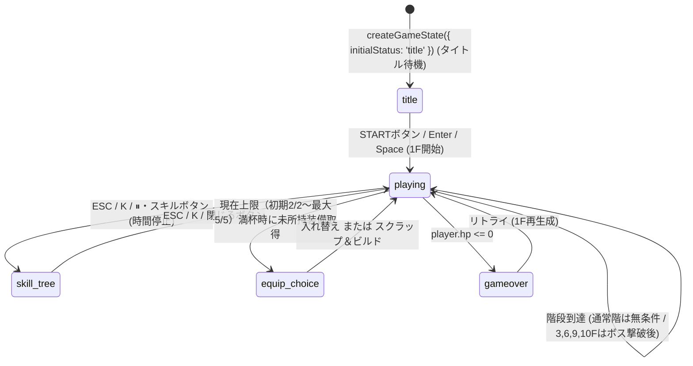

# 状態遷移図（State Transitions）

`GameState.status` を中心とした画面・進行状態および階層イベントの遷移定義です。

## 状態遷移一覧

| ID | 遷移元 | トリガー・条件 | 遷移先 | 状態 | 関連ID | 備考 |
| --- | --- | --- | --- | --- | --- | --- |
| ST-01 | `playing` | スキルボタン / `⏸` ボタン押下、または `ESC` / `K` キー入力 | `skill_tree` | Confirmed | BIZ-EXP-02, APP-MAP-02, APP-GRW-02, GLS-04, GLS-14, DEC-10 | シミュレーションを完全停止してポーズ兼スキル・装備詳細モーダル表示 |
| ST-02 | `skill_tree` | 閉じるボタン押下、または `ESC` / `K` キー入力 | `playing` | Confirmed | BIZ-EXP-02, APP-MAP-02, APP-GRW-02, GLS-04, GLS-14, DEC-10 | スキル配分を反映して探索再開 |
| ST-03 | `playing` | 装備枠（現在上限）が満杯の状態で未所持装備を拾う | `equip_choice` | Confirmed | BIZ-GRW-03, APP-GRW-03, PRM-05, DEC-07 | 入れ替えまたはスクラップ＆ビルド選択 |
| ST-04 | `equip_choice` | 入れ替えスロット選択またはスクラップ＆ビルド（所持装備1個強化／枠拡張蓄積）実行 | `playing` | Confirmed | BIZ-GRW-03, APP-GRW-03, GLS-09, DEC-07 | 選択結果を即時反映して探索再開 |
| ST-05 | `playing` | 階段に接触（通常階は無条件、3/6/9F守護中ボス階・10F毎大ボス階は `getStairsLockCount === 0` 後） | `playing（次階層 N+1F）` | Confirmed | BIZ-EXP-01, APP-MAP-01, INV-04, GLS-07, GLS-15, DEC-08, DEC-10 | ボス階は封印解除後に `advanceToNextFloor` 実行 |
| ST-06 | `playing` | 敵接触または敵弾被弾により `player.hp <= 0` | `gameover` | Confirmed | APP-MAP-02 | 到達階層・撃破数サマリーを表示 |
| ST-07 | `gameover` | リトライボタン押下 | `playing（1F新規生成）` | Confirmed | APP-MAP-01 | `createGameState()` でランを初期化 |
| ST-08 | `playing` | 探索中の任意ポーズ操作（`ESC` / `K` / HUD `⏸` ボタン） | `skill_tree（ポーズ兼装備詳細確認）` | Confirmed | BIZ-EXP-02, APP-MAP-02, GLS-14, OQ-04, DEC-10 | 時間停止してスキル強化と装備詳細スペックを確認可能 |
| ST-09 | `playing（10F毎到達）` | 安全前室の回復の泉接触（100%回復）→ 大ボスアリーナ交戦・撃破 → 階段接触 | `playing（11F等へ暫定エンドレス進行）` | Confirmed | BIZ-BOS-01, BIZ-BOS-02, APP-BOS-01, APP-BOS-02, GLS-10, GLS-15, PRM-16, DEC-10 | 安全前室・回復の泉・大ボス戦・11F以降継続を実装済み |
| ST-10 | `playing（10F毎大ボス撃破）` | 節目大ボス撃破後の正式なクリア祝勝モーダル／エンドレス継続選択UI | 未定義 | Disputed | BIZ-BOS-02, APP-BOS-02, GLS-11, PRM-16, DEC-06, DEC-10, OQ-02 | 暫定版11F自動継続は実装済みだが、正式なクリア達成演出・続行選択UIは未定 |
| ST-11 | `equip_choice` / `playing` | スクラップ＆ビルドまたはLv8同種拾得による枠拡張蓄積が段階コスト（2→3:1回, 3→4:2回, 4→5:3回）に到達（現在枠 < 5） | `playing（装備枠 +1・上限5）` | Confirmed | BIZ-GRW-03, BIZ-GRW-04, APP-GRW-03, APP-GRW-04, GLS-09, DEC-07, DEC-11, DEC-16, PRM-05 | 初期2枠→最大5枠。5枠到達後のLv8重複はHP/EXPボーナスへ還元 |
| ST-12 | `title` | STARTボタン押下、または `Enter` / `Space` キー入力 | `playing（1F開始）` | Confirmed | APP-MAP-01 | `startGame()` で待機状態を解除し、FLOOR 1F バナーを表示 |
