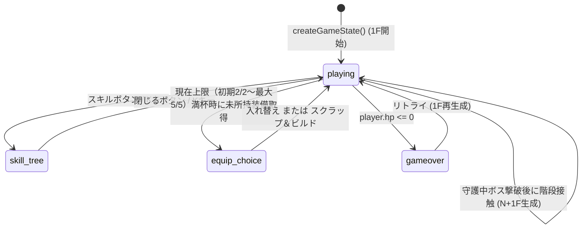

# 状態遷移図（State Transitions）

`GameState.status` を中心とした画面・進行状態および階層イベントの遷移定義です。

## 状態遷移一覧

| ID | 遷移元 | トリガー・条件 | 遷移先 | 状態 | 関連ID | 備考 |
| --- | --- | --- | --- | --- | --- | --- |
| ST-01 | `playing` | スキルボタン押下または `K` キー入力 | `skill_tree` | Confirmed | APP-GRW-02, GLS-04 | シミュレーションを一時停止してモーダル表示 |
| ST-02 | `skill_tree` | 閉じるボタン押下または `K` キー入力 | `playing` | Confirmed | APP-GRW-02, GLS-04 | スキル配分を反映して探索再開 |
| ST-03 | `playing` | 装備枠（現在上限）が満杯の状態で未所持装備を拾う | `equip_choice` | Confirmed | BIZ-GRW-03, APP-GRW-03, PRM-05, DEC-07 | 入れ替えまたはスクラップ＆ビルド選択 |
| ST-04 | `equip_choice` | 入れ替えスロット選択またはスクラップ＆ビルド（所持装備1個強化／枠拡張蓄積）実行 | `playing` | Confirmed | BIZ-GRW-03, APP-GRW-03, GLS-09, DEC-07 | 選択結果を即時反映して探索再開 |
| ST-05 | `playing` | 階段守護中ボス (`isRoomBoss`) を撃破 (`getStairsLockCount === 0`) し階段に接触 | `playing（次階層 N+1F）` | Confirmed | BIZ-EXP-01, APP-MAP-01, INV-04, GLS-07, DEC-08 | 封印解除後に `advanceToNextFloor` 実行 |
| ST-06 | `playing` | 敵接触または敵弾被弾により `player.hp <= 0` | `gameover` | Confirmed | APP-MAP-02 | 到達階層・撃破数サマリーを表示 |
| ST-07 | `gameover` | リトライボタン押下 | `playing（1F新規生成）` | Confirmed | APP-MAP-01 | `createGameState()` でランを初期化 |
| ST-08 | `playing` | 探索中の任意ポーズ操作（ESC等でのゲーム一時停止） | 未定義 | Unknown | BIZ-EXP-02, OQ-04 | スキル画面以外の汎用ポーズ状態・復帰導線が未定義 |
| ST-09 | `playing（節目階到達）` | 節目階（暫定10F毎）回復の泉部屋への遷移 | 未定義 | Disputed | BIZ-BOS-01, APP-BOS-01, GLS-10, PRM-16, DEC-06, OQ-01 | 再計画中・遷移先状態が未実装 |
| ST-10 | `playing（節目ボス撃破）` | 節目階（暫定10F毎）ボス撃破後のクリア／エンドレス継続選択 | 未定義 | Disputed | BIZ-BOS-02, APP-BOS-02, GLS-11, PRM-16, DEC-06, OQ-02 | 再計画中・エンドレス継続は別途検討 |
| ST-11 | `equip_choice` | スクラップ＆ビルドで枠拡張蓄積が3回に到達（現在枠 < 5） | `playing（装備枠 +1・上限5）` | Confirmed | BIZ-GRW-03, APP-GRW-03, GLS-09, DEC-07, PRM-05 | 初期2枠→最大5枠。装備種類追加時に再検討 |
